# RTL-to-GDS-Implementation-of-a-Low-Power-Configurable-Multi-Clock-Digital-System
RTL-to-GDS implementation of a low-power configurable multi-clock digital system, including RTL design, verification, synthesis, DFT, and physical design. 

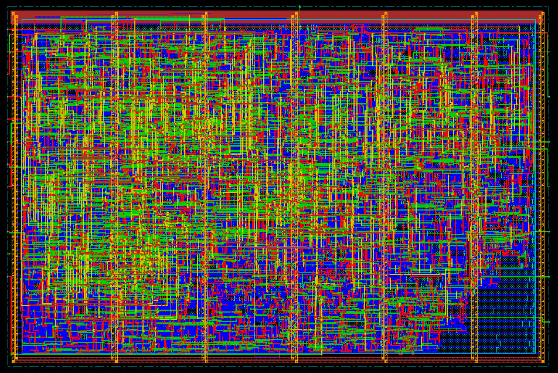

# Introduction

The **Low-Power Configurable Multi-Clock Digital System** is a digital system that receives commands from a master through the `UART_RX` interface, processes them using the ALU or Register File, and transmits the operation results back to the master through the `UART_TX` interface.

The system supports configurable operation modes, arithmetic and logical computations, register file access, and communication through a UART-based protocol.

## Supported Operations

### 1. ALU Operations

The ALU supports the following operations:

- Addition
- Subtraction
- Multiplication
- Division
- Bitwise AND, OR, NAND, NOR, XOR, and XNOR
- Comparison: `A = B`
- Comparison: `A > B`
- Logical right shift: `A >> 1`
- Logical left shift: `A << 1`

### 2. Register File Operations

- Register File Write
- Register File Read

## Supported Commands

The master communicates with the system using the following command types.

### 1. Register File Write Command — 3 Frames

Writes data to a specified register file address.

| Frame | Field | Description |
|---|---|---|
| Frame 0 | `RF_Wr_Addr` | Target register address |
| Frame 1 | `RF_Wr_Data` | Data to be written |
| Frame 2 | `RF_Wr_CMD` (`0xAA`) | Write command identifier |

### 2. Register File Read Command — 2 Frames

Requests data from a specified register file address. The command contains the read command identifier and the target address.

### 3. ALU Operation Command with Operands — 4 Frames

Requests an ALU operation with operands. The command includes the operation identifier and the required operand data.

### 4. ALU Operation Command without Operands — 2 Frames

Requests an ALU operation that uses operands already stored in the system's configuration or operand registers.

## System Specifications

| Parameter | Specification |
|---|---|
| Reference Clock (`REF_CLK`) | 50 MHz |
| UART Clock (`UART_CLK`) | 3.6864 MHz |
| Clock Divider Enable | Always enabled (`1`) |
| Communication Interface | UART RX / UART TX |

## Sequence of Operation

1. **Initial Configuration:** The testbench configures the system through Register File write commands targeting addresses `0x2` and `0x3`.
2. **Command Transmission:** The master, represented by the testbench, sends Register File or ALU commands.
3. **Command Reception:** `UART_RX` receives the transmitted command frames and forwards the decoded information for processing by `SYS_CTRL`.
4. **Command Processing:** `SYS_CTRL` coordinates the requested operation using the ALU or Register File.
5. **Result Transmission:** The system returns the operation result to the master through `UART_TX`.

## Register File Address Map

The Register File address space is divided into configuration/operand registers and general-purpose registers.

| Address Range | Purpose |
|---|---|
| `0x0` – `0x3` | Reserved for configuration and ALU operands |
| `0x4` – `0x15` | General-purpose Register File read/write operations |

The testbench should verify the supported commands, configuration sequence, data processing, and result transmission.

## Clock Domain Crossing (CDC) and Synchronization

The design includes dedicated synchronization modules and an asynchronous FIFO to support reliable communication across multiple clock domains. CDC and RDC checks were performed using **Synopsys SpyGlass** to identify potential clock-domain crossing, reset-domain crossing, and structural issues.

### 1. Synchronization Modules

#### Data Synchronizer (`DATA_SYNC`)
- Synchronizes signals crossing into a destination clock domain according to the implemented synchronization scheme.
- Helps reduce the risk of metastability during clock domain crossings.
- Provides synchronized signals to downstream logic.

#### Reset Synchronizer (`RST_SYNC`)
- Supports asynchronous reset assertion and synchronous reset deassertion.
- Synchronizes reset release with the destination clock domain.
- Helps reduce reset-release timing risks.

#### Asynchronous FIFO (`FIFO`)
- Transfers data between independent write and read clock domains.
- Provides buffering between producer and consumer logic.
- Uses CDC techniques to synchronize FIFO status information between clock domains.

#### Flip-Flop Synchronizer (`DF_SYNC`)
- Supports configurable synchronization stages and data width.
- Uses cascaded flip-flops to reduce the probability of metastability propagating into downstream logic.

### 2. SpyGlass CDC/RDC Verification

SpyGlass was used to analyze clock-domain crossings, synchronization structures, and reset-domain crossing behavior.

The verification flow includes:
- CDC structural analysis.
- Identification of potential unsafe crossings and convergence issues.
- Review of generated-clock usage.
- RDC structural analysis.
- Review of inferred latches associated with intentional clock-gating structures.

### 3. Waivers and Justifications

Selected SpyGlass findings were waived where the behavior was intentional or required design-specific interpretation. Waivers were documented with comments to clarify their rationale.

| Rule | Waiver rationale |
|---|---|
| `InferLatch` | Intentional latch inference associated with the clock-gating implementation (`Clock_Gate`). |
| `STARC05-1.4.3.4` | `TX_CLK_DIV_INST.div_clk` is an intentionally generated clock derived from the UART clock and used by the TX domain. |
| `Ac_conv01` | Convergence-related finding requiring design-specific review. |
| `Ac_conv02` | Convergence-related finding requiring design-specific review. |
| `Ac_clockperiod03` | Clock-period-related finding requiring review against the intended clock constraints. |

**Note:** Waivers document accepted or reviewed findings; they do not, by themselves, prove that a crossing is safe. Each waiver should be checked against the RTL, clock relationships, constraints, and SpyGlass reports.

### 4.CDC Verification Results

**CDC Verification**
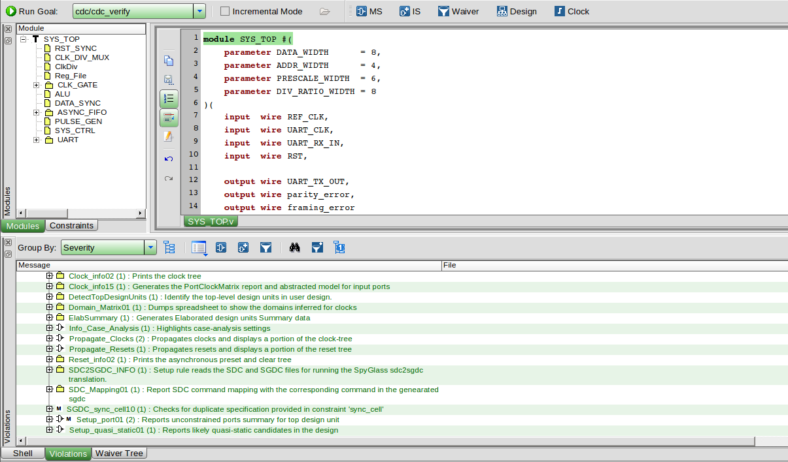

**CDC Structural Verification**
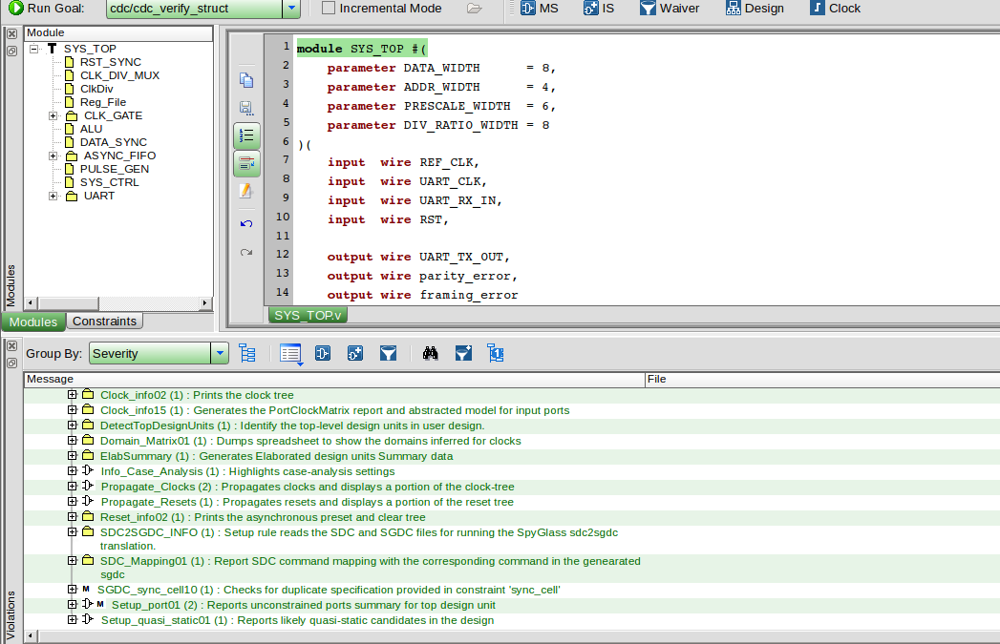

**CDC Abstract Results**
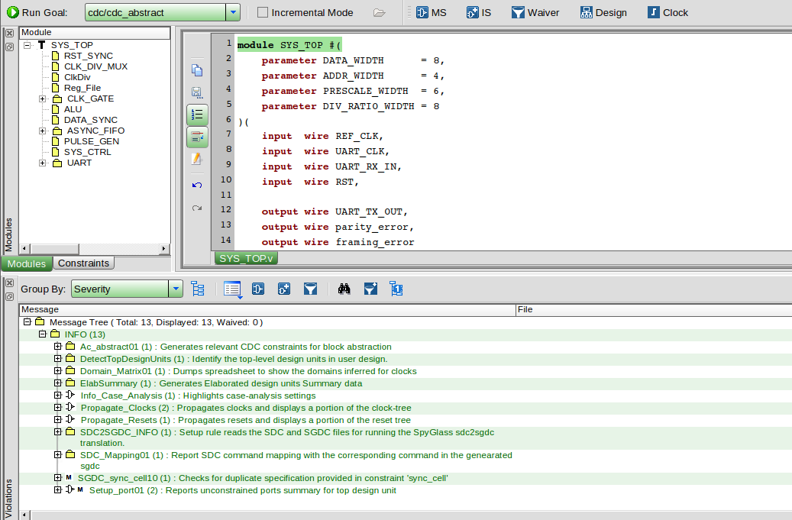

**CDC Setup Checks**
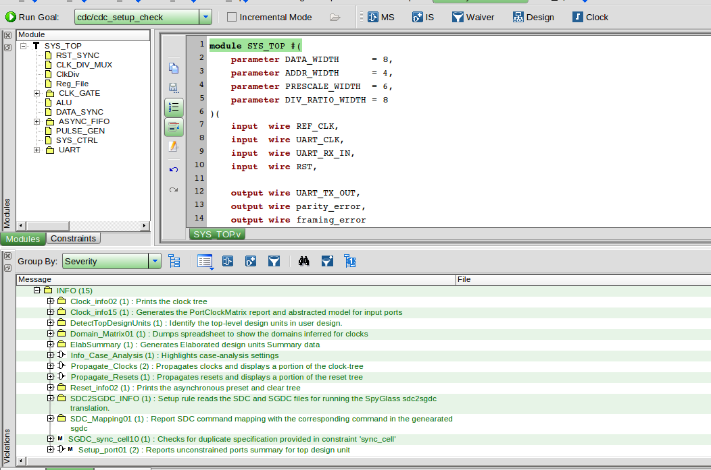

### RDC Verification Results

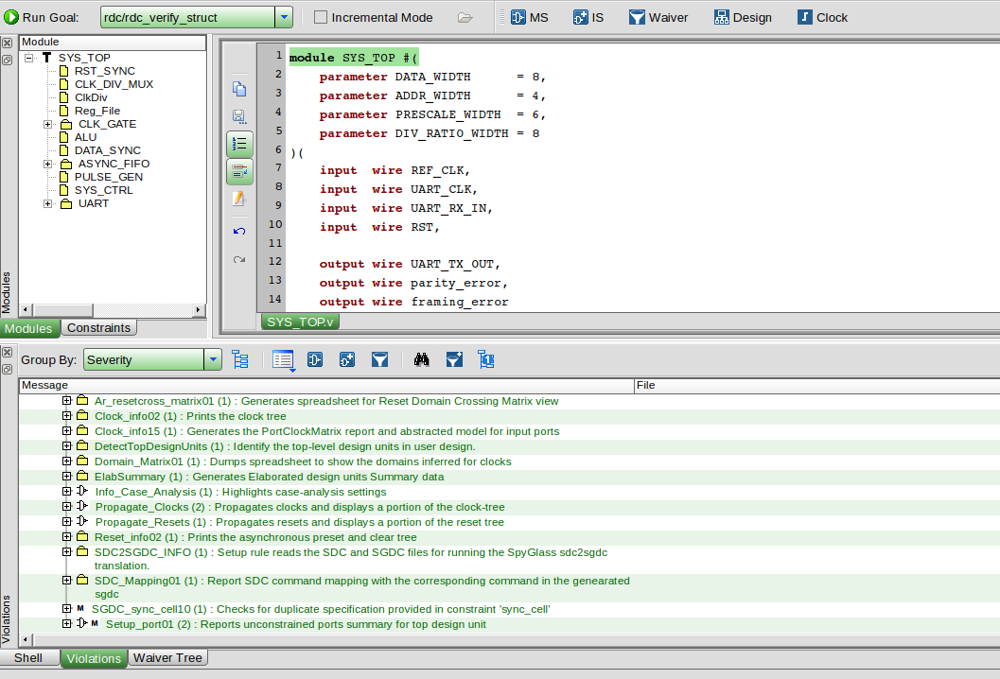

### RTL Lint Results

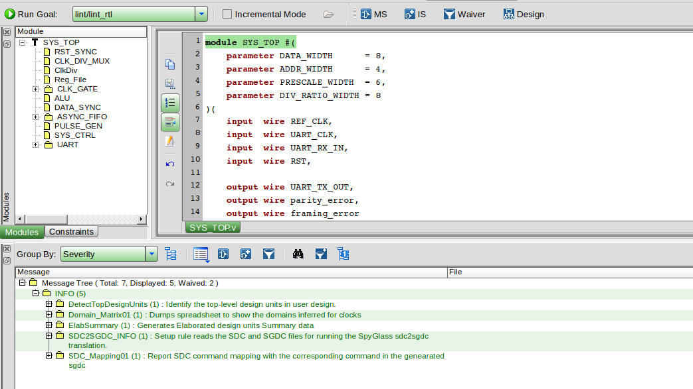

### Conclusion

The design incorporates synchronization modules and an asynchronous FIFO to support communication across multiple clock domains. SpyGlass CDC/RDC and lint analyses were performed, and selected findings were documented through explicit waivers. Final acceptance of the CDC/RDC results depends on reviewing the remaining findings and confirming that every waiver is justified by the design intent and verification evidence.

## Functional Verification

### 1. Overview

The final system verification was performed using the `SYS_TB` testbench in QuestaSim. The testbench executes **9 test suites**, each targeting a different UART configuration. The DUT is reset before each suite to ensure independent and repeatable testing.

The verification covers three UART prescale values and three parity modes.

| Prescale | Even Parity | Odd Parity | Parity Disabled |
|---:|---|---|---|
| 32 | Suite 1 | Suite 2 | Suite 3 |
| 16 | Suite 4 | Suite 5 | Suite 6 |
| 8 | Suite 7 | Suite 8 | Suite 9 |

### 2. Test Cases

| Test Group | Cases per Suite | Description |
|---|---:|---|
| Configuration and Divider Register Reads | 2 | Read `REG2` (UART configuration) and `REG3` (TX divider ratio) and compare them with the reference model. |
| Register Read Operations | 6 | Verify reads from addresses 4, 5, 6, 7, 8, and 15 after writing the corresponding values. |
| ALU Operations with Operands (`0xCC`) | 11 | Verify ADD, SUB, MUL, DIV, AND, OR, XOR, equality comparison, greater-than comparison, right shift, and left shift. |
| ALU Operations without Operands (`0xDD`) | 4 | Verify ADD, MUL, NAND, and right shift using values stored in `REG0` and `REG1`. |
| No False Error Flags | 1 | Verify that `parity_error` and `framing_error` remain low during valid traffic. |
| Parity Error Injection | 1 | Inject an incorrect parity bit and verify that `parity_error` is asserted when parity is enabled. |
| Framing Error Injection | 1 | Send a frame with a low stop bit and verify that `framing_error` is asserted. |
| Recovery After Error Frames | 1 | Read address 4 after error injection to verify that the system continues to operate correctly. |

**Additional stimulus:** Each suite includes UART configuration writes to `REG2`. Register writes to addresses 4, 5, 6, 7, 8, and 15 are checked through the subsequent read operations.

### 3. Verification Summary

| Suite Type | Cases per Suite | Number of Suites | Total Cases |
|---|---:|---:|---:|
| Parity Enabled (Even / Odd) | 27 | 6 | 162 |
| Parity Disabled | 26 | 3 | 78 |
| **Total** | — | **9** | **240** |

The testbench executes **240 test cases** across all nine UART configurations.

### 4. Checking Methodology

- **UART output checking:** The testbench waits for UART transmission to begin, with a timeout of 80 TX clock periods. It samples `UART_TX_OUT` and compares the received frame against the expected frame, including the start bit, data bits, optional parity bit, and stop bit, using case equality (`===`).
- **Reference models:** `RF_MODEL` models the expected register-file contents, while the `ALU_LOW` function calculates the expected ALU result.
- **Error monitoring:** Event monitors detect rising edges of `parity_error` and `framing_error` and record whether each error flag was asserted.
- **Final test summary:** The testbench reports the total, passed, and failed test counts, followed by `ALL TESTS PASSED` or `SOME TESTS FAILED`.

### 5. Simulation Results

The following figures document the functional verification process and simulation results.

#### System Verification Summary

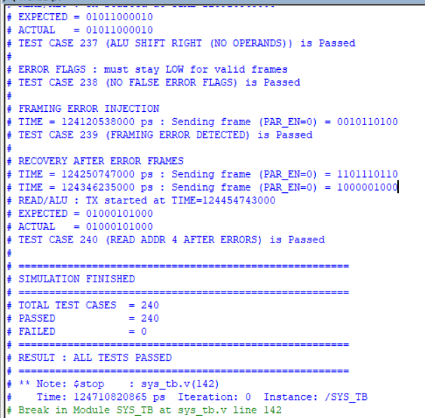

#### Simulation Waveforms

The following waveform captures illustrate selected simulation signals and testbench activity.

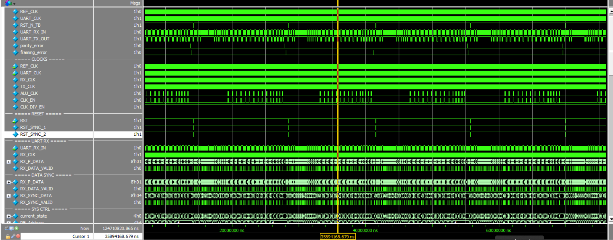

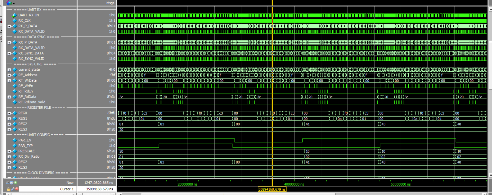

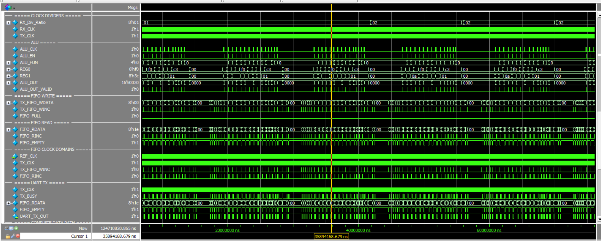

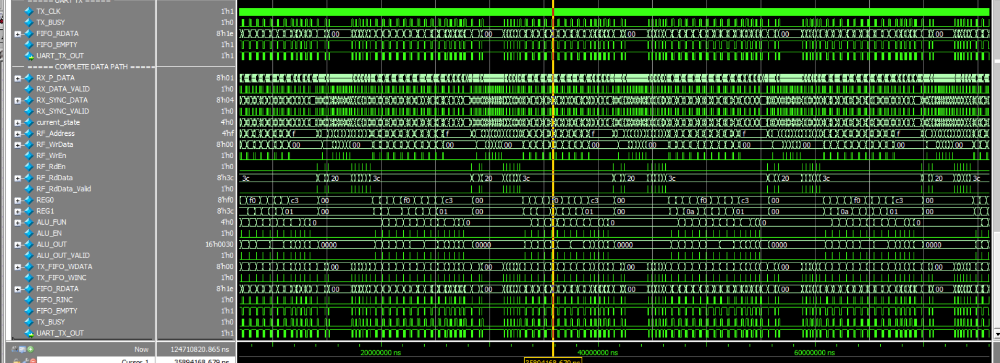

## Logic Synthesis

Logic synthesis was performed using **Synopsys Design Compiler** to transform the RTL description of `SYS_TOP` into a technology-mapped gate-level netlist using the target TSMC standard-cell libraries.

The synthesis flow included RTL elaboration, design linking and consistency checks, constraint application, logic optimization, technology mapping, and generation of the synthesized netlist and implementation files.

### Synthesis Configuration

- **Synthesis Tool:** Synopsys Design Compiler
- **Top Module:** `SYS_TOP`
- **Target Technology:** TSMC 130 nm standard-cell library
- **Synthesis Script:** [`syn_script.tcl`](Syn/syn_script.tcl)
- **Timing Constraints:** Defined in [`cons.tcl`](Syn/cons.tcl)
- **Clock Domains:** `REF_CLK`, `UART_CLK`, and their generated clocks
- **Timing Analysis:** Setup and hold timing reports generated under the specified operating conditions

### Synthesis Results

| Metric | Result |
|---|---:|
| Total cell instances | 1,910 |
| Combinational cells | 1,491 |
| Sequential cells | 381 |
| Total cell area | 21,999.58 |
| Reported setup-path slack | 4.23 ns |
| Reported hold-path slack | 0.33 ns |
| Constraint violations | no violated constraints |

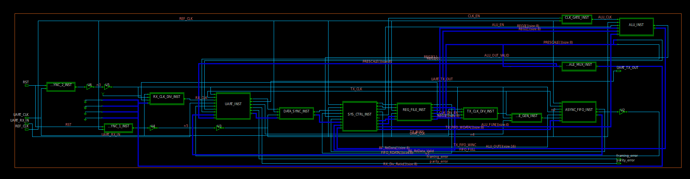

### Synthesis Reports

The synthesis reports are available in the [`Syn_Reports`](Syn/reports) directory.

The reports include:

- **Area Report (`area.rpt`):** Cell-count statistics and hierarchical area distribution.
- **Power Report (`power.rpt`):** Estimated switching, internal, leakage, and total power.
- **Setup Timing Report (`setup.rpt`):** Maximum-delay timing paths.
- **Hold Timing Report (`hold.rpt`):** Minimum-delay timing paths.
- **Clock Report (`clocks.rpt`):** Clock periods, generated clocks, and clock attributes.
- **Constraint Report (`constraints.rpt`):** Reported timing-constraint violations.

Additional generated files include the synthesized gate-level netlist, Design Compiler database, SDF, and exported SDC constraints.

## Formal Verification — Post-Synthesis

Formal equivalence checking was performed using **Synopsys Formality** to verify that the synthesized gate-level netlist of `SYS_TOP` is functionally equivalent to the original RTL reference design.

The verification flow used the RTL source files as the reference design and the synthesized Verilog netlist generated by Design Compiler as the implementation design. The synthesis guidance file (`SYS_TOP.svf`) was provided to assist Formality in correlating RTL transformations with the synthesized implementation.

### Verification Configuration

- **Formal Verification Tool:** Synopsys Formality
- **Top Module:** `SYS_TOP`
- **Reference Design:** RTL source files
- **Implementation Design:** Synthesized gate-level netlist (`SYS_TOP.v`)
- **Technology:** TSMC 130 nm standard-cell libraries
- **Synthesis Guidance:** `SYS_TOP.svf`
- **Verification Flow:** Design setup, compare-point matching, and formal equivalence checking

### Formal Verification Results

| Metric | Result |
|---|---:|
| Passing compare points | 364 |
| Failing compare points | 0 |
| Aborted compare points | 0 |
| Unverified compare points | 0 |
| Overall result | **PASS** |

All 364 reported compare points passed, with no failing, aborted, or unverified compare points. This confirms that the synthesized implementation is formally equivalent to the RTL reference design for the checked design points.

### Verification Reports

The Formality reports are available in the [`Post_Syn_FM_Reports`](Post_Syn_FM/reports) directory.

The Formality flow generates the following reports:

- **`passing_points.rpt`:** Lists compare points successfully proven equivalent.
- **`failing_points.rpt`:** Lists compare points that fail equivalence checking.
- **`aborted_points.rpt`:** Lists compare points for which the verification process was aborted.
- **`unverified_points.rpt`:** Lists compare points that were not verified.

The main verification script is `syn_fm_script.tcl`, and the execution log is saved as `logs/syn_fm_log.log`.

## Design for Test (DFT)

Design for Test (DFT) was implemented using **Synopsys Design Compiler** to introduce scan-based test structures into the `SYS_TOP` design, improving controllability and observability for manufacturing test.

The flow includes scan configuration, test-protocol generation, pre-DFT design-rule checking, scan insertion, incremental optimization, post-DFT DRC, and fault-coverage estimation.

### DFT Configuration

| Parameter | Configuration |
|---|---|
| Top Module | `SYS_TOP_DFT` |
| EDA Tool | Synopsys Design Compiler |
| Target Technology | TSMC 130 nm standard-cell library |
| Scan Style | Multiplexed flip-flop |
| Clock Mixing | `no_mix` |
| Maximum Scan Chain Length | 100 |
| Scan Clock | `scan_clk` |
| Scan Enable | `SE` |
| Scan Input / Output | `SI` / `SO` |
| Test Mode | `test_mode` |
| Scan Clock Period | 100 ns (10 MHz) |

### DFT Implementation Flow

1. **Design Setup:** Read the RTL source files, link the target libraries, and check design consistency.
2. **Scan Configuration:** Configure multiplexed scan flip-flops with clock mixing disabled and a maximum chain length of 100.
3. **Test Protocol Generation:** Define the scan signals and timing, then create the test protocol.
4. **Pre-DFT DRC:** Check the design for testability issues before scan insertion.
5. **Scan Insertion:** Insert scan structures using `insert_dft`.
6. **Post-DFT Optimization:** Perform incremental optimization using `compile -scan -incremental`.
7. **Post-DFT DRC:** Run test design-rule checks and estimate fault coverage.
8. **Output Generation:** Export the gate-level netlist, SDF, SDC, and synthesis reports.

### DFT Design Rule Checking Results

The post-DFT DRC reported one violation associated with a constant logic value at the clock-gating cell.

| Metric | Result |
|---|---:|
| Total DRC violations | 1 |
| Valid scan cells | 360 |
| Sequential cells checked by DFT DRC | 361 |
| Constant-value violations | 1 |
| Violation code | `TEST-505` |
| Affected instance | `CLK_GATE_DFT_INST/U0_TLATNCAX12M` |

The remaining 360 checked scan cells were reported as valid. The constant-value violation should be investigated before describing the DFT design as DRC-clean.

### Fault Coverage Estimation

The post-DFT coverage estimation processed 15,990 faults and reported the following results.

| Fault Classification | Count |
|---|---:|
| Detected | 15,721 |
| Possibly detected | 0 |
| Undetectable | 206 |
| ATPG untestable | 51 |
| Not detected | 12 |
| **Estimated test coverage** | **99.60%** |

The reported fault coverage is an estimate generated by Design Compiler. The tool notes that actual coverage may differ when a customized test protocol and test simulation library are used. Therefore, the 99.60% result should be interpreted as an estimated coverage metric, not as proof of complete fault detection in silicon.

### Post-DFT Synthesis Results

| Metric | Result |
|---|---:|
| Total cell instances | 1,952 |
| Combinational cells | 1,526 |
| Sequential cells | 381 |
| Buffer / inverter cells | 284 |
| Total cell area | 24,758.95 library area units |
| Reported setup slack | 18.52 ns |
| Reported hold slack | 0.42 ns |

The reported timing slacks are from the displayed pre-layout timing paths under the configured operating conditions and ideal-clock assumptions. These values do not represent post-route timing results.

### Clock Configuration

| Clock | Period |
|---|---:|
| `REF_CLK` | 20 ns |
| `ALU_CLK` | 20 ns |
| `UART_CLK` | 271.297 ns |
| `RX_CLK` | 271.297 ns |
| `TX_CLK` | 8,681.50 ns |
| `SCAN_CLK` | 100 ns |

Functional clock relationships and the scan clock are constrained separately in the timing constraints.

### Power Estimation

The synthesis power report estimates total power at **0.132 mW**. The report also warns that primary inputs and sequential-cell outputs have unannotated switching activity. Accordingly, this value is a preliminary estimate rather than a fully activity-annotated power measurement.

### Generated Files and Reports

The DFT flow generates the following files:

- `reports/area.rpt` — Cell statistics and hierarchical area distribution.
- `reports/power.rpt` — Estimated switching, internal, leakage, and total power.
- `reports/setup.rpt` — Maximum-delay timing paths.
- `reports/hold.rpt` — Minimum-delay timing paths.
- `reports/clocks.rpt` — Clock periods and generated-clock relationships.
- `netlists/SYS_TOP_DFT.v` — Synthesized gate-level Verilog netlist.
- `sdf/SYS_TOP_DFT.sdf` — Standard Delay Format file.
- `sdc/SYS_TOP_DFT.sdc` — Exported timing constraints.

The main script is `dft_script.tcl`, and the execution log is available in `log/dft.log`.

### Formal Equivalence Verification — Post-DFT

Formal equivalence checking was performed using Synopsys Formality to compare the `SYS_TOP_DFT` RTL reference design against the gate-level netlist generated after DFT insertion.

**Comparison configuration:**
- `test_mode = 0`
- `SE = 0` (functional mode)
- Scan-in (`SI`) and scan-out (`SO`) ports excluded from compare-point verification.

**Results:**

| Metric | Result |
|---|---:|
| Passing compare points | 364 |
| Failing compare points | 0 |
| Aborted compare points | 0 |
| Unverified compare points | 0 |
| Tool | Synopsys Formality L-2016.03-SP1 |

### Generated Reports

- `reports/passing_points.rpt` — Successfully matched and verified compare points.
- `reports/failing_points.rpt` — Compare points that failed equivalence checking.
- `reports/aborted_points.rpt` — Compare points for which verification was aborted.
- `reports/unverified_points.rpt` — Compare points that were not verified.
- `logs/pnr_fm_log.log` — Formality execution log.
- `pnr_fm_script.tcl` — Formality setup and verification script.

**Conclusion:** All 364 reported compare points passed under the configured functional-mode comparison conditions.

## Physical Design: Place & Route (Post-PnR)

### Overview

The `SYS_TOP_DFT` design was taken through the physical implementation flow using Cadence Innovus and a TSMC 130 nm standard-cell technology. The flow covered floorplanning, power planning, standard-cell placement, clock tree synthesis (CTS), post-CTS hold fixing, global and detailed routing, physical verification, and design data export.

### Implementation Flow

1. **Floorplanning:** Loaded the floorplan and established the core and die configuration.
2. **Power Planning:** Created the power distribution network using power rings, power stripes, and standard-cell power connections.
3. **Placement:** Placed standard cells and performed pre-CTS optimization.
4. **Tie-Cell Insertion:** Inserted 3 `TIELOM` cells and 6 `TIEHIM` cells.
5. **Clock Tree Synthesis (CTS):** Built clock distribution trees for `UART_CLK`, `REF_CLK`, and `scan_clk`.
6. **Post-CTS Optimization:** Fixed hold timing violations by inserting delay cells.
7. **Global and Detailed Routing:** Routed signal interconnects and performed via and wire optimization.
8. **Filler Insertion:** Inserted 1,579 filler cells.
9. **Post-Route Verification and Export:** Generated physical verification reports and exported the gate-level netlist, parasitic data, SDF, power report, and GDSII layout.

### Timing Closure Results

| Implementation Stage | Setup WNS | Hold WNS | Placement Density |
|---|---:|---:|---:|
| Pre-CTS | +2.633 ns | — | 73.7% |
| Post-CTS, Before Hold Fixing | +2.619 ns | -0.554 ns | 77.8% |
| Post-CTS, After Hold Fixing | +2.619 ns | +0.072 ns | 78.1% |
| Post-Route | +2.589 ns | +0.077 ns | 78.1% |

**Result:** The reported post-route setup and hold WNS values are both positive, indicating that the reported timing checks meet their constraints. The final reported setup WNS is **+2.589 ns**, and hold WNS is **+0.077 ns**.

### Hold-Time Optimization

After CTS, the design exhibited hold-time violations with a worst negative slack of **-0.554 ns across 132 violating paths**.

Hold optimization inserted 10 `DLY4X1M` delay cells across four nets. The reported total negative slack improved from approximately **-29.2 ns to 0 ns**, and the post-route hold WNS became positive at **+0.077 ns**.

### Clock Tree Synthesis Results

| Clock | Number of Sinks | Reported Post-Route Skew | Frequency |
|---|---:|---:|---:|
| `REF_CLK` | 280 | 65.7 ps | 50 MHz |
| `UART_CLK` | 78 | 102 ps | 3.6864 MHz |
| `scan_clk` | 358 | 143 ps | 10 MHz |

The reported scan-clock skew is below the stated 200 ps target.

The functional clock configuration also includes:

- `ALU_CLK`: 50 MHz
- `RX_CLK`: 3.6864 MHz
- `TX_CLK`: approximately 115.2 kHz

### Physical Verification Results

| Check | Reported Result |
|---|---|
| DRC / Verify Geometry | 0 violations |
| Connectivity | 0 violations |
| Process Antenna | 0 violations |
| Design Rule Violations (capacitance, transition, fanout) | 0 final reported violations |
| Post-Route Setup Timing | WNS = +2.589 ns |
| Post-Route Hold Timing | WNS = +0.077 ns |

These results reflect the reported implementation and verification checks. They do not, by themselves, establish complete foundry sign-off or tape-out readiness.

### Implementation Statistics

- **Top Module:** `SYS_TOP_DFT`
- **Technology:** TSMC 130 nm
- **Standard-Cell Count:** Approximately 1,831–1,836, as reported during implementation
- **Tie Cells:** 3 `TIELOM` and 6 `TIEHIM`
- **Hold-Fixing Cells:** 10 `DLY4X1M`
- **Filler Cells:** 1,579

The reported cell count may vary by implementation stage and by whether filler, tie, and other physical-only cells are included.

### Generated Outputs

| File | Purpose |
|---|---|
| `SYS_TOP_DFT.v` | Post-PnR gate-level netlist |
| `SYS_TOP_DFT_pg.v` | Gate-level netlist with power and ground pins |
| `SYS_TOP_DFT.spf` | Extracted parasitic information in SPF format |
| `SYS_TOP_DFT.sdf` | Standard Delay Format timing annotation file |
| `power.rpt` | Power analysis report |
| `SYS_TOP_DFT.gds` | GDSII layout export |

### Remaining Sign-Off Considerations

Although the reported post-route timing and physical checks are clean, several issues require further review before treating the layout as sign-off ready:

1. **RC Extraction Configuration:** `SOCEXT-5027` reported that no QX technology file was defined for the RC corner. Complete the extraction setup and verify timing with the intended parasitic corner.
2. **GDSII Layer Mapping:** The `streamOut` log reported a layer-map parsing warning. The generated GDS contained 3,506 instances, but nets, pins, and text were not reported as exported. Validate the layer map and inspect the resulting GDS in a layout viewer before relying on the file.
3. **Scan-Chain Configuration:** Warnings including `SOCSP-9025` indicated that no scan chain was specified or traced during part of the flow. Verify the scan-chain setup and confirm that the intended scan connectivity is preserved.
4. **Clock Transition:** Clock-buffer transition values reportedly reached approximately 190 ps against a stated 50 ps target. Review the applicable constraints and final transition reports, even though no final DRV violations were reported.
5. **Power Estimation:** Missing internal and leakage power data for tie cells may affect the reported power estimate.
6. **Final Run Completion:** The available log ends around a `saveDesign` operation with a `SOCSYT-3036` warning. Confirm that the run completed successfully and that all output files are valid.

**Conclusion:** The reported Post-PnR results show positive setup and hold slack, zero reported final geometry and connectivity violations, and completed routing. However, RC extraction configuration, scan-chain tracing, and GDSII export validation remain important checks before claiming full physical sign-off.

### Formal Equivalence Verification — Post-PnR

Formal equivalence checking was performed using Synopsys Formality to compare the `SYS_TOP_DFT` RTL reference design against the gate-level implementation netlist exported after the Place-and-Route flow.

**Comparison configuration:**
- `test_mode = 0`
- `SE = 0` (functional mode)
- Scan-in (`SI`) and scan-out (`SO`) ports excluded from compare-point verification.

**Results:**

| Metric | Result |
|---|---:|
| Passing compare points | 364 |
| Failing compare points | 0 |
| Aborted compare points | 0 |
| Unverified compare points | 0 |
| Tool | Synopsys Formality L-2016.03-SP1 |

### Generated Reports

- `reports/passing_points.rpt` — Successfully matched and verified compare points.
- `reports/failing_points.rpt` — Compare points that failed equivalence checking.
- `reports/aborted_points.rpt` — Compare points for which verification was aborted.
- `reports/unverified_points.rpt` — Compare points that were not verified.
- `logs/pnr_fm_log.log` — Formality execution log.
- `pnr_fm_script.tcl` — Formality setup and verification script.

**Conclusion:** All 364 reported compare points passed, with no failing, aborted, or unverified points under the configured functional-mode comparison conditions.

### Gate-Level Simulation (GLS) — Post-PnR

Gate-Level Simulation was performed using Questa to validate the functional behavior of the `SYS_TOP_DFT` gate-level implementation netlist with SDF timing annotation.

**Simulation configuration:**
- **Gate-level netlist:** `SYS_TOP_DFT.v`
- **Standard-cell library model:** `tsmc13_m.v`
- **Timing annotation file:** `SYS_TOP_DFT.sdf`
- **SDF annotation mode:** Maximum delays (`-sdfmax`)
- **Testbench:** `SYS_DFT_TB_FUNC`
- **Operating mode:** Functional mode (`test_mode = 0`, `SE = 0`)
- **Simulator:** Questa/ModelSim

**Results:**

| Metric | Result |
|---|---:|
| Total test cases | 27 |
| Passed test cases | 27 |
| Failed test cases | 0 |
| Simulator errors | 0 |
| Simulator warnings | 34 |

### Verification Coverage

- Register-file read and write operations.
- UART configuration and divider-register checks.
- ALU operations, including arithmetic, logical, comparison, and shift functions.
- Parity-error detection.
- Framing-error detection.
- Functional recovery following injected UART errors.

### Simulation Files

- `SYS_DFT_TB_FUNC.v` — Functional gate-level testbench.
- `run_GLS.do` — Questa/ModelSim simulation and SDF annotation setup.
- `SYS_TOP_DFT.v` — Gate-level implementation netlist.
- `SYS_TOP_DFT.sdf` — Standard Delay Format timing data.
- `tsmc13_m.v` — Standard-cell simulation models.
- `SYS_DFT_TB_FUNC.vcd` — Simulation waveform dump, if retained.

**Conclusion:** All 27 reported test cases passed with zero simulator errors. The simulation was run with maximum-delay SDF annotation. The 34 warnings should be reviewed to confirm successful timing annotation and determine whether any warnings affect the validity of the simulation results.

### Power Analysis — Post-PnR

Time-based power analysis was performed using Synopsys PrimeTime PX on the `SYS_TOP_DFT` gate-level implementation netlist. Switching activity was imported from the functional GLS waveform, and SDF timing data was loaded for timing-aware power estimation.

**Analysis configuration:**
- **Tool:** Synopsys PrimeTime O-2018.06-SP1
- **Design:** `SYS_TOP_DFT`
- **Power analysis mode:** Time-based
- **Operating condition:** Typical corner, 1.2 V, 25°C
- **Timing data:** `SYS_TOP_DFT_rem.sdf`
- **Switching activity:** `SYS_DFT_TB_FUNC.vcd`
- **Activity annotation:** 2047 of 2083 nets (98.27%)
- **Fully annotated leaf cells:** 1918 of 1918
- **Analysis window:** 0 to 5.6 × 10⁶ ns, as reported by PrimeTime PX

**Power Results:**

| Metric | Result |
|---|---:|
| Total power | 449.8 µW |
| Cell internal power | 325.6 µW |
| Net switching power | 116.9 µW |
| Cell leakage power | 7.331 µW |
| Peak power | 0.1903 W |

### Power Report Breakdown

The register file and asynchronous FIFO were the largest reported contributors to total power under the analyzed activity conditions.

- `REG_FILE_INST`: 26.3%
- `ASYNC_FIFO_INST`: 15.3%
- `SYS_CTRL_INST`: 6.2%
- `DATA_SYNC_INST`: 2.3%
- `UART_INST`: 0.8%

### Generated Reports

- `pt/SYS_TOP_DFT.rpt` — Overall time-based power report.
- `pt/SYS_TOP_DFT_hier.rpt` — Hierarchical power breakdown.
- `pt/not_annotated.rpt` — Nets without directly annotated switching activity.

**Conclusion:** PrimeTime PX completed the time-based power analysis and generated overall and hierarchical power reports. The reported total power was 449.8 µW for the analyzed window. VCD time-unit consistency, unannotated nets, and timing-related warnings should be reviewed before treating these values as final power sign-off results.

### Tools Used

| **Work** | **Tool** |
|---|---|
| Formal Verification / GLS | QuestaSim |
| Lint and CDC | Synopsys SpyGlass |
| Synthesis and Scan Insertion | Synopsys Design Compiler / DFT Flow |
| Equivalence Checking | Synopsys Formality |
| Placement, CTS, and Routing | Cadence Encounter |
| Time-Based Power Estimation | Synopsys PrimeTime |
