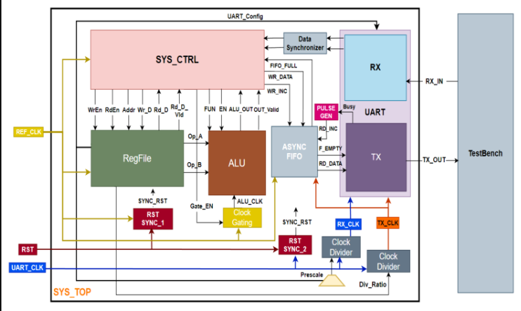

# RTL-to-GDS-Implementation-of-a-Low-Power-Configurable-Multi-Clock-Digital-System
RTL-to-GDS implementation of a low-power configurable multi-clock digital system, including RTL design, verification, synthesis, DFT, and physical design. 

# Introduction

The **Low-Power Configurable Multi-Clock Digital System** is a digital system that receives commands from a master through the `UART_RX` interface, processes them using the ALU or Register File, and transmits the operation results back to the master through the `UART_TX` interface.

The system supports configurable operation modes, arithmetic and logical computations, register file access, and communication through a UART-based protocol.

## Supported Operations

### 1. ALU Operations

The ALU supports the following operations:

- Addition
- Subtraction
- Multiplication
- Division
- Bitwise AND, OR, NAND, NOR, XOR, and XNOR
- Comparison: `A = B`
- Comparison: `A > B`
- Logical right shift: `A >> 1`
- Logical left shift: `A << 1`

### 2. Register File Operations

- Register File Write
- Register File Read

## Supported Commands

The master communicates with the system using the following command types.

### 1. Register File Write Command — 3 Frames

Writes data to a specified register file address.

| Frame | Field | Description |
|---|---|---|
| Frame 0 | `RF_Wr_Addr` | Target register address |
| Frame 1 | `RF_Wr_Data` | Data to be written |
| Frame 2 | `RF_Wr_CMD` (`0xAA`) | Write command identifier |

### 2. Register File Read Command — 2 Frames

Requests data from a specified register file address. The command contains the read command identifier and the target address.

### 3. ALU Operation Command with Operands — 4 Frames

Requests an ALU operation with operands. The command includes the operation identifier and the required operand data.

### 4. ALU Operation Command without Operands — 2 Frames

Requests an ALU operation that uses operands already stored in the system's configuration or operand registers.

## System Specifications

| Parameter | Specification |
|---|---|
| Reference Clock (`REF_CLK`) | 50 MHz |
| UART Clock (`UART_CLK`) | 3.6864 MHz |
| Clock Divider Enable | Always enabled (`1`) |
| Communication Interface | UART RX / UART TX |

## Sequence of Operation

1. **Initial Configuration:** The testbench configures the system through Register File write commands targeting addresses `0x2` and `0x3`.
2. **Command Transmission:** The master, represented by the testbench, sends Register File or ALU commands.
3. **Command Reception:** `UART_RX` receives the transmitted command frames and forwards the decoded information for processing by `SYS_CTRL`.
4. **Command Processing:** `SYS_CTRL` coordinates the requested operation using the ALU or Register File.
5. **Result Transmission:** The system returns the operation result to the master through `UART_TX`.

## Register File Address Map

The Register File address space is divided into configuration/operand registers and general-purpose registers.

| Address Range | Purpose |
|---|---|
| `0x0` – `0x3` | Reserved for configuration and ALU operands |
| `0x4` – `0x15` | General-purpose Register File read/write operations |

The testbench should verify the supported commands, configuration sequence, data processing, and result transmission.
